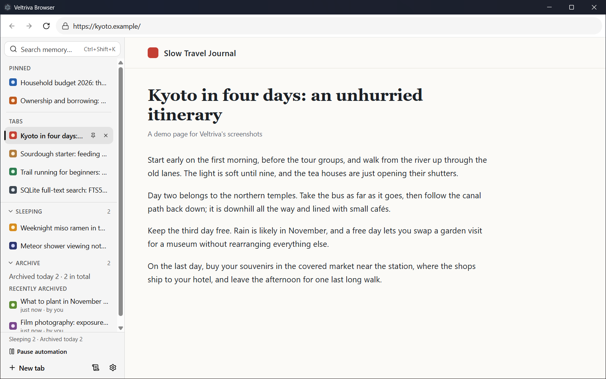
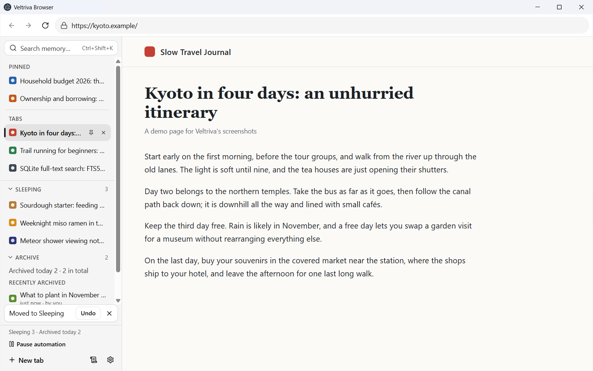
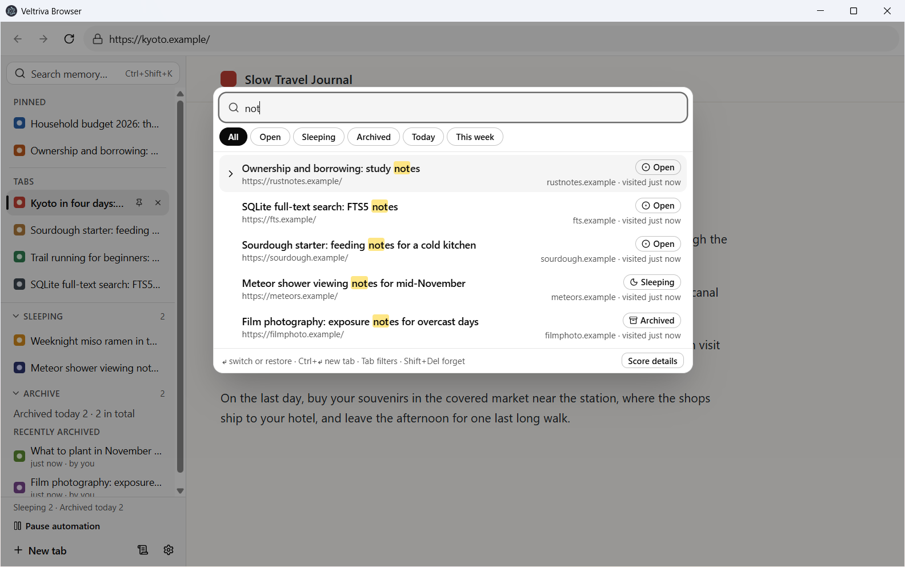
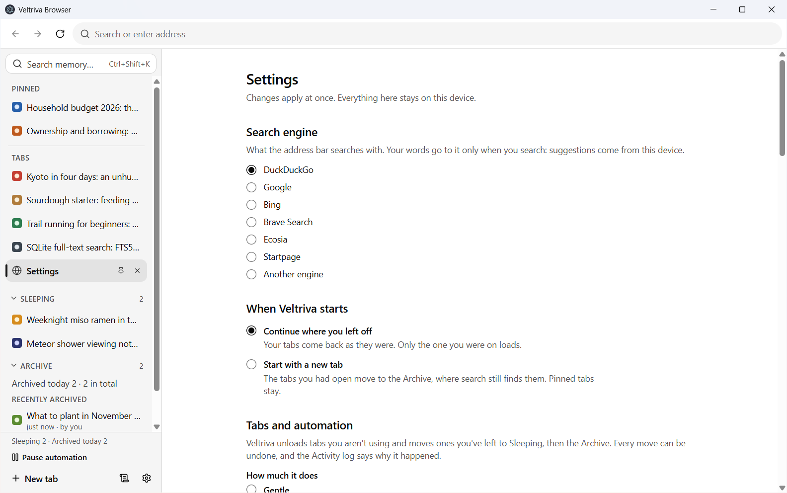

# Veltriva Browser

> **Browse freely. Remember effortlessly.**

Veltriva is a local-first Windows browser built on Chromium (through Electron 45). It is for people who keep 50 or 100 tabs open because closing one feels like losing it. Veltriva manages those tabs for you: it unloads the ones you left to free memory, moves the ones you stopped using out of the way, and remembers every page you visit. A few partial words and Ctrl+Shift+K bring any of them back. Everything it remembers stays on your computer.

**Status:** version 0.1.0, for Windows 10 and 11 (x64). The builds are unsigned, so Windows SmartScreen warns about them (see [Install, update and uninstall](#install-update-and-uninstall)). It is not published yet: the repository has no remote, and publishing is the owner's decision. Until it is, you build the installer yourself with `npm run package:installer` or the release script (see [Install](#install-update-and-uninstall)). Published releases will be on the project's GitHub releases page.

## Install, update and uninstall

- **Get the installer.** There is no download yet. `npm run package:installer` builds `release/Veltriva-Browser-Setup-<version>.exe`, and `npm run release -- <version>` does that and more (setup is in [docs/development.md](docs/development.md); the release steps are in [docs/distribution/releasing.md](docs/distribution/releasing.md)). Once releases are published, each one will come with a `SHA256SUMS.txt` to check the file against.
- **Install.** Run the installer. It is one click, per user, and needs no administrator rights. It installs into `%LOCALAPPDATA%\Programs\veltriva`, adds Start-menu and desktop shortcuts named "Veltriva Browser", and starts Veltriva when it is done.
- **SmartScreen.** Because the installer is unsigned, Windows may show "Windows protected your PC" with "Unknown publisher". Choose **More info ▸ Run anyway**. Edge and Chrome may also say the file "isn't commonly downloaded"; choose **Keep**. SmartScreen builds a reputation per file, so each new version shows the warning until enough people have run it. [docs/distribution/signing.md](docs/distribution/signing.md) explains why, and what changes once builds are signed.
- **First start.** A welcome page asks three things: which search engine to use, how much Veltriva should tidy for you (the preset), and whether automation should show its moves first before making them. You can change all three later in Settings.
- **Your data.** Your profile is `%APPDATA%\Veltriva`: tabs, history, settings, site data and the log file.
- **Update.** Run a newer installer. It replaces the app, keeps your profile and asks nothing. Veltriva does not update itself; it can tell you when a newer version exists (see [About and the update notice](#about-and-the-update-notice)).
- **Uninstall.** Open Settings ▸ Apps ▸ Installed apps ▸ Veltriva Browser ▸ Uninstall. It confirms ("Are you sure you want to uninstall Veltriva Browser?"), then asks **"Also remove your Veltriva data from this computer?"** No is the default: it keeps your profile for a later install. Yes deletes `%APPDATA%\Veltriva`. A silent uninstall (`"%LOCALAPPDATA%\Programs\veltriva\Uninstall Veltriva.exe" /currentuser /S`) keeps the profile too; add `--delete-app-data` to remove it.

## What it does

### Tabs and the sidebar

- **A vertical sidebar** lists your tabs, pinned ones first. Reorder them by dragging, or with Alt+Shift+Up and Alt+Shift+Down. A tab's menu (right-click, or Shift+F10) offers Duplicate, Pin, Move to Sleeping, Archive, Protect from automation and Close other tabs, among others.
- **The address bar** has back, forward and reload. Type an address or a search. It searches with DuckDuckGo unless you choose another engine.
- **Recently closed:** Ctrl+Shift+T brings back a closed tab with its history, even after a restart, for 7 days.
- **Veltriva's own pages:** a new tab, `veltriva://settings` (also the gear at the foot of the sidebar), `veltriva://diagnostics`, `veltriva://about` and `veltriva://welcome`.
- **Light and dark** follow Windows' setting.

### Tabs that look after themselves

- **Unloading:** a tab hidden for an hour (the Balanced preset) is unloaded to free its memory. It stays in the sidebar, and comes back when you select it, with its back and forward history, where you had scrolled and, within the same run, what you typed in plain fields.
- **Sleeping, then the Archive:** past your 10 most recent unpinned tabs, a tab you have not used for 2 hours of use moves to Sleeping, under the tab list. After 3 days of use there, it moves to the Archive. One click brings a tab back next to the one you are on. These times count your use of the computer, so a weekend away changes nothing.
- **Presets:** Gentle, Balanced and Aggressive set how fast all this happens. Balanced is the default; Gentle is slower and Aggressive faster, and Aggressive also unloads pinned tabs. Settings shows every value behind them.
- **Memory pressure:** when your computer's memory runs low, the tabs left longest are unloaded first, one at a time when it is moderately low and up to three when it is critical. The tab you are using is never touched. Pressure only unloads tabs; it never moves them in the sidebar.
- **Tabs it leaves alone:** one that is playing sound or video, using the camera or microphone, in fullscreen, with DevTools open, or with a sign-in or payment window open; one with unsaved work (typed-in fields, or a page that asks "Leave site?"); one you protected, or whose site you protected. Some reasons are softer: a site you allowed to send notifications, a chat or inbox active in the background, a tab you used in the last 15 minutes, an editor in focus, or a page with a password or payment field. When memory is critically low, those can give way.
- **Preview:** for your first 3 days of use, automation only marks the tabs it would move to Sleeping or the Archive, so you can see what it would do. It still unloads tabs. **Start now** ends the preview early.
- **Undo and Activity:** every move to Sleeping or the Archive, yours or automation's, has an Undo in a toast at the foot of the sidebar. **Activity** lists every automatic action and the rule behind it. A tab's tooltip says why it is unloaded, or what keeps it awake.
- **Pause automation** in the sidebar stops all of it, and **Protect from automation** in a tab's menu keeps one tab as it is. **"Leave page?"** asks before you close a page that warns about unsaved changes.

### The memory and search

- **Every page you visit is remembered,** with its title and icon, in your profile only. Left out: sign-in callbacks, addresses with a password in them, and parameters that carry a token or a signature. Tracking parameters (`utm_*`, `fbclid` and the like) do not make a page count twice. Veltriva searches titles, addresses and sites, not the text of pages.
- **The memory palette, Ctrl+Shift+K** (or **Search memory…** in the sidebar): type a few partial words of a title, an address or a site. Enter switches to the tab, or brings it back from Sleeping or the Archive; Ctrl+Enter opens it in a new tab. Tab steps through All, Open, Sleeping, Archived, Today and This week, and `site:example.com` keeps to one site. Shift+Delete forgets the selected result. The page underneath stays live.
- **What you use comes first:** a page open in a tab, then Sleeping, then archived, and pages you visit often and recently, rank above a better word match alone. Punctuation and search-engine syntax are ignored.
- **The address bar suggests** pages from your memory as you type, with **Switch to tab** for one that is already open. Nothing you type leaves your machine until you press Enter.
- **The Archive list** shows every archived tab, thousands of them, smoothly.

### Everyday browsing

- **Find in page:** Ctrl+F, with match counts.
- **Zoom,** per site, in Chrome's steps, with an indicator in the address bar.
- **Print:** Ctrl+P, or **Print…** in a page's menu, opens Windows' print dialog.
- **Downloads** go to your Downloads folder under safe, unique names, with progress, pause, cancel, Open and Show in folder in a panel under the toolbar. Programs and other risky types stay unrunnable until you choose Keep. Nothing is ever opened for you.
- **Permissions:** a page that wants your camera, microphone, location, notifications or clipboard asks in a strip under the toolbar, naming the site. Your answer is remembered, and you can change it in Settings. Everything else is refused.
- **Pop-ups** open only right after you click or press a key in the page; otherwise they are blocked, and the strip offers to open them. Sign-in and payment pop-ups open in a small window with a read-only address bar.
- **Other apps:** a link to another app (Zoom, Teams, email) opens it only after you click it and say yes. Dangerous link types are always refused.
- **Certificate errors:** a site whose certificate cannot be trusted gets a warning page with no way past it, and so does a site that asks for a client certificate.
- **Sign-in:** a site that asks for a password (HTTP authentication) gets a sign-in form in the toolbar strip. The password is sent once and never stored.
- **PDFs** open in Chromium's built-in viewer.
- **DevTools:** F12 opens a page's DevTools in their own window.
- **Fullscreen:** a page that asks for fullscreen gets it, with a notice naming the site.
- **Context menus** for pages, links, images, text fields and spelling, and for each sidebar tab.

### Session restore and crash recovery

- **Your tabs come back** where you left them, pinned ones first, the same one selected, each with its back and forward history. Only the selected tab loads; the others load when you pick them. The window opens where it was, and tabs come back where you had scrolled, except pages with a password or payment field.
- **After a crash** a notice says your tabs are back. After two crashes in a row right after starting, Veltriva opens your tabs without loading any (safe mode).
- **Nothing secret is saved:** passwords in addresses, and sign-in tokens after a `#`, are left out.
- **The database looks after itself:** after a crash the file is checked, and a damaged one is set aside and restored from a backup (a notice says so). A backup is taken daily while you are away, and quitting never waits more than 3 seconds for it.
- **One Veltriva at a time:** opening it again brings the open window to the front.

### Settings, privacy and your data

Open Settings with the gear at the foot of the sidebar, or `veltriva://settings`. Every change applies at once.

- **Search engine:** DuckDuckGo, Google, Bing, Brave Search, Ecosia, Startpage, or another engine's address.
- **When Veltriva starts:** continue where you left off, or start with a new tab (the tabs you had go to the Archive, and pinned ones stay).
- **Tabs and automation:** the presets, described plainly, and every value behind them, including when memory counts as low.
- **Pause memory:** stop remembering pages without opening a private window. Your tabs, Sleeping and the Archive work as usual.
- **Site rules:** protect a site from automation, or do not remember it at all: its pages are never recorded, its tabs are never archived by automation, and closing one keeps no record. Set them here or from a tab's menu.
- **Clear data:** what was recorded in the last hour, 24 hours or 7 days, or everything, with the archived and recently closed tabs if you like. You can add Chromium's cookies, site data and cached files, but Chromium cannot clear those by time, so they go for all time whatever range you pick. It is deleted for good: the database is rewritten, so the words are gone from the file too. Open and Sleeping tabs stay.
- **Forget a site:** its pages, visits and tabs, and if you like its cookies, storage, cached files and permissions.
- **Site permissions:** what you allowed or blocked, the apps a site's links open, and the browser details it asked for. Change any of them, or remove one so the site asks again.
- **How long pages are kept:** 365 days unless you choose otherwise.

### Diagnostics

- **`veltriva://diagnostics`** shows each tab's memory, what automation did in the last day, every change of memory pressure, how often you took back a tab automation had just moved, the database's size and last backup, and the log. It never leaves your machine.
- **Export diagnostics…** saves that page as a JSON file for a problem report. It never holds a page's title, and holds no address unless you tick the box.
- **A log file,** `logs\veltriva.log` in your profile, holds one line per warning or error, rotated at 5 × 5 MB. It names tab ids and error codes, not what you browsed. **Diagnostic logging** in Settings adds the addresses of the pages concerned, for as long as you leave it on. **Show the log folder** on the diagnostics page opens it.

### About and the update notice

- **`veltriva://about`** shows the versions of Veltriva, Electron, Chromium, Node.js and V8, the MIT license and the third-party notices.
- **The update notice is off by default.** While it is off, Veltriva makes no request, no DNS lookup and runs no timer for it. Turn it on under Settings ▸ Updates ▸ Check for new versions. Then Veltriva asks GitHub's latest-release API for the newest version 2 minutes after it starts and once a day, or when you press **Check now**. A newer version shows a notice with **View release**, **Skip this version** and **Dismiss**. Nothing is downloaded or installed.
- **Leave it off until releases are published.** The repository has no remote yet, so until a release exists a check finds nothing, or fails and says so.

## Privacy

- **Nothing leaves your machine from Veltriva's own features:** no telemetry, no crash reports, no cloud, no account, no sync and no remote search suggestions. Your pages, tabs, history and settings are stored in your profile only.
- **The only network traffic Veltriva itself makes** is the pages you visit (and the search engine you chose, when you press Enter on a search), site icons for those pages, and, only if you turn it on, the update check. Icon requests are checked first so a page cannot send Veltriva to your own network (one gap remains, under Known limitations); see [the security review](docs/security/security-review.md).
- **Spell checking** uses Windows' own spellchecker. Veltriva does not download dictionaries.
- **You are in control of what is kept:** Pause memory, site rules, Clear data, Forget a site, and the retention period. See [Settings, privacy and your data](#settings-privacy-and-your-data).
- **Logs hold no addresses** unless you turn on Diagnostic logging.

## Accessibility

Veltriva's own interface (the toolbar, the sidebar, the palette, the prompts and its pages) aims for WCAG 2.2 AA. You can use it with the keyboard alone: F6 cycles the address bar, the sidebar's selected tab and the page, and the sidebar and the palette have their own arrow-key navigation. Screen readers are told how many suggestions and results there are, what the palette's filter is, and when an Undo or a prompt appears. Focused controls get a visible focus ring, and animations stand still when Windows' animation effects are off. An axe-core check runs against the interface in the light and the dark theme as part of the test suite. Veltriva does not paint its own colors for Windows contrast themes. What automated checks cannot judge (Narrator, keyboard order, text size, contrast themes) is checked by hand: see [docs/testing/accessibility.md](docs/testing/accessibility.md).

## Keyboard shortcuts

The browser keeps these keys for itself, so a page can't block them:

| Keys | Action |
|---|---|
| Ctrl+T | New tab |
| Ctrl+W, Ctrl+F4 | Close the tab |
| Ctrl+Shift+T | Reopen the last closed tab |
| Ctrl+Tab, Ctrl+Shift+Tab | Next or previous tab |
| Ctrl+1 to Ctrl+8, Ctrl+9 | Go to that tab, or to the last one |
| Ctrl+L, Alt+D | Go to the address bar |
| F6 | Move between the address bar, the selected tab in the sidebar and the page, in that order |
| F5, Ctrl+R | Reload |
| Shift+F5, Ctrl+F5, Ctrl+Shift+R | Reload without the cache |
| Alt+Left, Alt+Right | Back or forward |
| F11 | Fullscreen (it also ends a page's fullscreen) |
| F12 | The page's DevTools |
| Ctrl+Shift+K | The memory palette: search your tabs and history |

A page gets these keys first, and the browser acts only if the page doesn't use them. That way a web app with its own find, such as an online editor, keeps it:

| Keys | Action |
|---|---|
| Ctrl+F | Find in page |
| F3, Ctrl+G and Shift+F3, Ctrl+Shift+G | Next or previous match |
| Ctrl+Plus, Ctrl+Minus, Ctrl+0 | Zoom in, zoom out, or back to 100% (also Ctrl+mouse wheel) |
| Ctrl+P | Print the page (Windows' print dialog) |

Esc leaves a page's fullscreen. AltGr combinations always go to the page, because they type characters on many keyboard layouts.

In the sidebar, Up, Down, Home and End move between tabs, Enter or Space selects one, Alt+Shift+Up and Alt+Shift+Down reorder it, Delete closes it, and Shift+F10 (or the Menu key) opens its menu. In the palette, Enter and Ctrl+Enter open a result, Tab changes the filter, Shift+Delete forgets a result, and Esc closes it.

## Benchmarks

Search is measured, end to end through the app's own data layer, on a synthetic memory. At 50,000 pages the 95th-percentile search took 10.3 ms (median of 3 runs, on the reference laptop, which was under load). The method, the other sizes and the raw data are in [docs/benchmarks/search.md](docs/benchmarks/search.md). The memory benchmark, which compares tabs live, in Sleeping and unloaded, is reported in [docs/benchmarks/memory.md](docs/benchmarks/memory.md); [docs/benchmarks/phase-3-memory.md](docs/benchmarks/phase-3-memory.md) records the earlier attempt. Both can be run again: see [docs/development.md](docs/development.md).

## Known limitations

Stated plainly, as the assessment's §6.7 asks:

- **Pages' `alert` and `confirm` boxes block the whole window** until you answer them, even one from a background tab, and they don't name the site that asks. A page's `prompt()` shows nothing and gets no answer. Electron offers no way to make them per tab yet; the box offers "Prevent this app from creating additional dialogs" from a page's second one.
- **A link inside a page that asks you to stay doesn't ask you**: the page keeps you. Typing an address, reloading, going back or forward, and closing the tab all ask "Leave page?".
- **No Safe Browsing** protection against phishing or malware, and **no DRM video** (Widevine).
- **The database isn't encrypted at rest**, like mainstream browsers' history databases; Windows account security and BitLocker protect it. Another program running as you can still read it.
- **Unsaved-work detection is a heuristic**: Veltriva keeps a tab it can see you typed in, or one that asks before leaving, but a page that saves work in other ways may lose it when unloaded.
- **Site icons are decoded by Veltriva's own interface**, in its sandboxed renderer: only raster images up to 64 KB, checked by their bytes, but not re-encoded yet.
- **A site's icon request can still be steered by DNS rebinding**: Veltriva checks every address an icon's host resolves to, and every redirect, before asking, but a name whose answer changes between that check and the request itself isn't caught.
- **Unsigned builds** until code signing is in place, so Windows SmartScreen warns about them.
- **Not tested on clean Windows 10 and 11 virtual machines yet.** The installer has been run end to end on the development machine only; the clean-machine check is in the final manual checklist.
- **Left out of this version:** multiple windows and dragging a tab out, private windows, sync, extensions, a password manager and autofill, ad and tracker blocking, and macOS and Linux. There are no bookmarks or history page; search the memory instead.
- **Chromium security fixes** reach Veltriva with each Electron release, a little after Chrome.

## Documentation

- [Technical assessment and architecture proposal](docs/architecture/technical-assessment.md)
- [Architecture decision records](docs/adr/README.md)
- [Phase 0 spike reports](docs/spikes/README.md)
- [MVP gap audit](docs/plans/mvp-gap-audit.md): every §7.2 item against what Veltriva does, and where the rest gets done
- [Phase plans](docs/plans/): what each phase built, where it differs from the plan, and the evidence
- [Development guide](docs/development.md): requirements, setup, scripts, project layout and CI
- [Releasing](docs/distribution/releasing.md) and [code signing](docs/distribution/signing.md)
- [Security review](docs/security/security-review.md)
- [Accessibility checks](docs/testing/accessibility.md)
- [Final manual checklist](docs/testing/final-manual-checklist.md)
- [Benchmarks](docs/benchmarks/)

## License

[MIT](LICENSE). Third-party licenses are in [THIRD_PARTY_NOTICES.txt](THIRD_PARTY_NOTICES.txt), which is also shown in `veltriva://about` and ships in the installed app. Chromium's and Node.js's own licenses are in `LICENSES.chromium.html`, next to `Veltriva.exe`.
