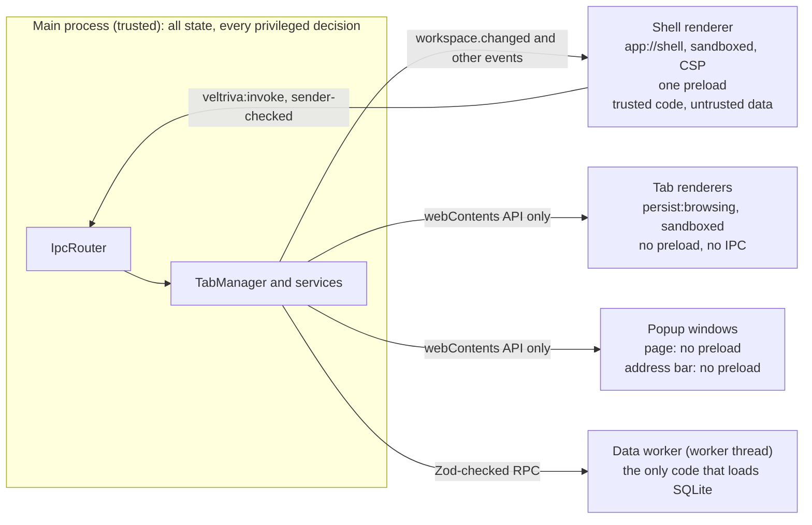
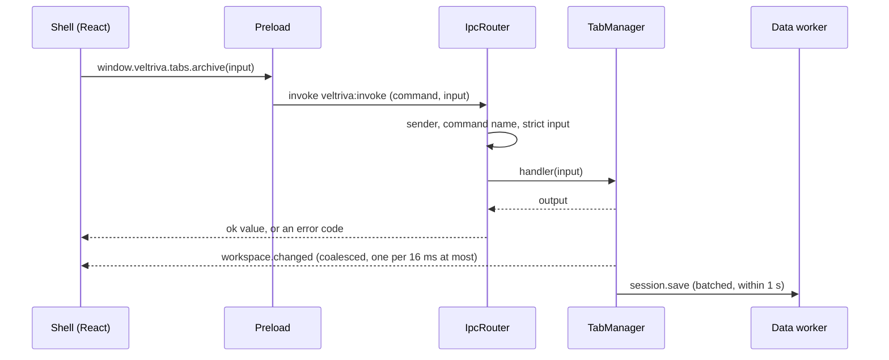
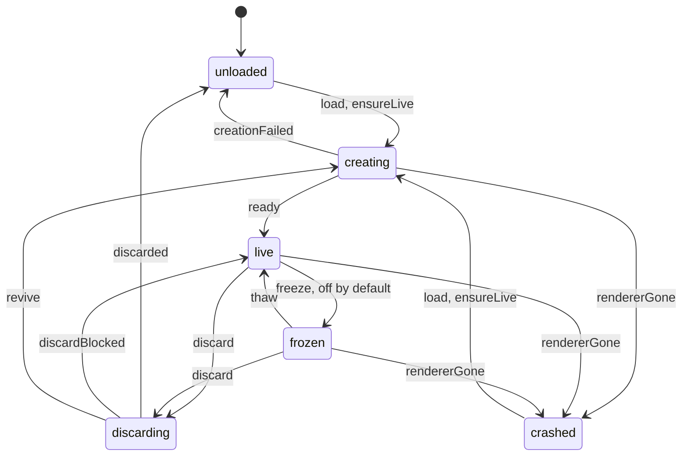

# Architecture overview (v0.1.0, as built)

This is the short version of how Veltriva Browser v0.1.0 works. It is written from the code, not from a plan. Each section ends with the code to open and the ADRs and assessment sections that hold the depth.

- **The [ADRs](../adr/README.md) are the source of truth** for decisions. Each one records "as built" items per phase.
- **The [technical assessment](technical-assessment.md)** is the original proposal, written before the build and amended by phase. Where it differs from what was built, trust this overview and the ADRs.
- **If this overview and the code disagree, the code is right.** Fix this file.

## At a glance

- **One Electron app, four trust zones.** Electron 45 (Chromium 156, Node 24), one `BaseWindow`, one `WebContentsView` per live tab. Main, the data worker, the shell UI and the tab renderers each get only the powers they need.
- **Main owns all state.** The shell is a projection. It sends intents and receives versioned snapshots.
- **SQLite lives in one worker thread.** Main never loads it, and the build checks that.
- **Tabs have four dimensions:** placement, runtime, activity and protection. A pure policy turns facts into actions, and every action names its rule.
- **Inactivity is measured in your time,** on an engagement clock, so a weekend away moves nothing.
- **Everything stays local.** There is no telemetry, no crash upload and no account. Main's own network requests are favicon fetches (and their DNS lookups) for pages you opened, and an update check that is off by default.
- **Test builds differ from production builds.** Test hooks are compiled out of production, and the build refuses to package them.

### The source tree

| Folder | What lives there | What it may import |
|---|---|---|
| [`src/core`](../../src/core) | Pure logic: lifecycle policy and state machine, URL rules, search ranking, permission and protocol rules, session sanitizing | No Electron, no Node (ESLint and `tsconfig.core.json`) |
| [`src/shared`](../../src/shared) | The IPC and data-RPC contracts (Zod), the settings schema, constants | The same |
| [`src/data`](../../src/data) | The data worker: SQLite, migrations, repositories, upkeep | Node and better-sqlite3, no Electron |
| [`src/main`](../../src/main) | The main process: TabManager, services, web policy, IPC router, windows | Electron and Node. Never `src/data`, never SQLite |
| [`src/preload`](../../src/preload) | The one preload, for the shell only | `electron` only |
| [`src/renderer`](../../src/renderer) | The shell UI: React 19, Zustand, Tailwind 4, shadcn/ui | No Node, no Electron |

## 1. Processes and trust zones

**The zones**

- **Main process.** [`src/main/index.ts`](../../src/main/index.ts) is the composition root. Before `ready` it sets the profile folder, the AppUserModelID and the sandbox (`app.enableSandbox()`). It also cleans the user agent, registers the `app://` scheme and installs the web-contents guard and the session baseline. Moving any of that later weakens it.
- **Data worker.** A `worker_threads` worker built as a second main-process entry, `out/main/data-worker.js`. Main starts it by file name and imports none of its code. It is trusted and owns the only SQLite connection.
- **Shell renderer.** One `WebContentsView` with the `shell` role. It loads `app://shell` on the in-memory session `veltriva-shell`, so it keeps no web storage and "clear browsing data" cannot touch it. It is sandboxed and context-isolated, has no Node, and has one preload that exposes the typed command API.
- **Tab renderers.** One `WebContentsView` per live tab, role `tab`, session `persist:browsing`. `TAB_WEB_PREFERENCES` ([`web-preferences.ts`](../../src/main/web/web-preferences.ts)) has sandbox, context isolation, no Node in any frame or worker, `webSecurity`, `safeDialogs` and **no `preload`**. A page has no channel to main.
- **Popup windows.** A popup is its own `BaseWindow`. It hosts the contents Chromium pre-created for `window.open` (role `popup`, same policy as a tab, the opener's session), so `window.opener` and `postMessage` keep working. Above the page sits a read-only address bar: a `shell`-role view of `app://shell/popup-bar.html`, with no preload and so no IPC. Main pushes it the text to show.
- **Other sessions.** `veltriva-updates` is an in-memory session used only by the update check. The default session gets the same baseline, and no tab or popup uses it. DevTools front ends get the `devtools` role.

**Roles.** Every web contents gets exactly one role when it is created. Creation code claims the role while it builds the view (`createViewWithRole`, [`roles.ts`](../../src/main/web/roles.ts)). Unclaimed `remote` contents is `devtools`. Anything else is `unknown` and cannot navigate at all.

| Role | Navigation allowed | IPC |
|---|---|---|
| `shell` | None (blocked) | The main window's shell has the preload. The popup bar has none |
| `tab`, `popup` | `http:`, `https:`, `about:blank`, a `blob:` document with a web origin. Subframes also get `about:srcdoc`, `data:`, `blob:` and the PDF viewer's frame | None |
| `devtools` | Managed by Electron | None |
| `unknown` | None | None |

**The guards**

- **Web-contents guard** ([`guard.ts`](../../src/main/web/guard.ts), [`navigation-policy.ts`](../../src/main/web/navigation-policy.ts)). It runs on `web-contents-created` for every contents. It blocks `<webview>` and denies `window.open` until a role installs its own handler. It cancels Bluetooth chooser requests. It checks every navigation in `will-navigate`, `will-frame-navigate` and `will-redirect`. `veltriva:`, `app:`, `file:` and top-level `data:` are blocked. A link to another app goes to the protocol guard instead.
- **Session baseline** ([`session-baseline.ts`](../../src/main/web/session-baseline.ts)). It runs on `session-created`, so every session starts denying. Permission request, check and device handlers deny. Display media gets `null`. The HID, serial and USB choosers are cancelled. Downloads are cancelled unless the download manager handles that session. Client certificates are declined, and HTTP and proxy authentication go to main's sign-in prompt or are cancelled. There is no certificate-error handler, so Electron keeps rejecting bad certificates. Spellcheck dictionary downloads point at the loopback discard port.
- **Permission broker** ([`permission-broker.ts`](../../src/main/permissions/permission-broker.ts), rules in [`src/core/permissions`](../../src/core/permissions)). It replaces the deny-all handlers on the browsing session only, and works from an allow-list. See section 8.
- **IPC sender checks.** Covered in section 3.
- **Electron fuses** in the packaged binary. Covered in section 10.

**Read more:** [ADR-0002](../adr/0002-trust-zones-and-web-policy.md), [ADR-0001](../adr/0001-platform-electron.md), [assessment §3.1](technical-assessment.md#31-process-model-and-trust-zones), [§6.2](technical-assessment.md#62-hardening-configuration), [§6.4](technical-assessment.md#64-navigation-popups-protocols-permissions-downloads).

## 2. The window and its views

- **One native-frame `BaseWindow`** ([`main-window.ts`](../../src/main/windows/main-window.ts)). The shell view fills the window underneath everything. Its view background is transparent (`#00000000`), and CSS paints the opaque state.
- **LayoutManager** ([`layout-manager.ts`](../../src/main/windows/layout-manager.ts)) sizes the selected tab's view to the content area: the window minus the insets the shell reports with `layout.setInsets`. Only the selected tab's view is attached above the shell. Hidden live tabs are detached. Unloaded tabs have no view.
- **Destruction is explicit.** Electron never destroys a view's web contents for you. A close runs `removeChildView`, then `webContents.close()`, then drops every reference. When the window closes, TabManager closes the tabs in the window's `closed` event, after LayoutManager stops touching the destroyed window.
- **Background restores** attach the view invisibly under every other view (`attachHidden`). Restoring into a detached view leaves the scroll position off by the display scale factor.
- **Overlays use the transparent shell (ADR-0006, option A′).** HTML cannot cover a native view, so for the palette and the address bar's suggestions the shell clears its own content area (`<html data-overlay>`), waits two frames, and sends `overlay.show`. Main then re-adds the shell view above the tab and gives it the keyboard. The page underneath stays `visible` and unthrottled. This works only while the shell's document root is transparent, and a lifecycle check asserts that (`tests/lifecycle/raised-shell.test.ts`).
- **Raise reasons** are named: `fullscreen-notice`, `palette`, `suggestions`. The shell stays above the tab while any reason holds.
- **HTML fullscreen.** The selected tab fills the window ([`fullscreen.ts`](../../src/main/windows/fullscreen.ts)). The shell raises a notice naming the page's origin for 4 s. Main raises it only after the shell reports it shows nothing else, with a 500 ms fallback. Main can end fullscreen whatever the page's script does.
- **FocusManager** ([`focus-manager.ts`](../../src/main/focus/focus-manager.ts)) decides whether the shell or a page has the keyboard. Ctrl+L, Alt+D, Ctrl+T and Ctrl+F go to the shell. A typed navigation that commits returns focus to its page. F6 cycles the address bar, the sidebar's selected tab and the page.
- **Shortcuts never travel over IPC.** Reserved keys are matched in `before-input-event` on the shell and on every tab ([`shortcuts.ts`](../../src/main/input/shortcuts.ts)). Find, zoom and print are accelerators of a window menu that is never shown, so a page that handles the key first keeps it ([`page-menu.ts`](../../src/main/input/page-menu.ts)). There is no default application menu. Context menus are native.
- **Internal pages are drawn by the shell**, not loaded into any web contents. Nine exist: `new-tab`, `network-error`, `certificate-error`, `client-certificate`, `crashed`, `diagnostics`, `settings`, `welcome` and `about` ([`internal-pages.ts`](../../src/core/url/internal-pages.ts)). The user can type five of them as `veltriva://…`.

**Read more:** [ADR-0006](../adr/0006-overlay-strategy.md), [ADR-0002 items 2 and 8](../adr/0002-trust-zones-and-web-policy.md), [ADR-0009](../adr/0009-mvp-product-decisions.md), [assessment §3.3](technical-assessment.md#33-window-composition-and-overlays-question-2), [§3.9](technical-assessment.md#39-keyboard-and-focus).

## 3. State ownership and IPC

- **Single writer.** [TabManager](../../src/main/tabs/tab-manager.ts) and the services around it are the only writers of domain state. It has no Electron imports: each tab's web contents sits behind the `TabRuntime` port, with [`tab-runtime.ts`](../../src/main/tabs/tab-runtime.ts) in the app and fakes in tests.
- **The contract** is in [`src/shared/contracts`](../../src/shared/contracts). `ipc.ts` holds the names, the two channels (`veltriva:invoke`, `veltriva:event`) and the error codes, with no Zod. `schemas.ts` holds a strict `{ input, output }` Zod pair per command and a payload schema per event. The type checker requires every name to have a schema and every schema a name. At v0.1.0 that is 68 commands and 6 events.
- **The preload** ([`shell.ts`](../../src/preload/shell.ts)) builds a frozen `window.veltriva.<namespace>.<method>(input?)` from the command list, plus `on(event, listener)` for the listed events. It never exposes `ipcRenderer`, the event object or a generic send.
- **The router** ([`router.ts`](../../src/main/ipc/router.ts), [`sender.ts`](../../src/main/ipc/sender.ts), [`install.ts`](../../src/main/ipc/install.ts)) checks in this order:
  1. The sender: role `shell`, main frame, origin `app://shell`. The dev-server origin is allowed in development builds only. An untrusted sender gets `forbidden` even for an unknown command name.
  2. The command name.
  3. The input, with the strict schema. Unknown keys are rejected.
  4. The handler, then the output schema.
- **Errors are codes:** `forbidden`, `unknown_command`, `invalid_input`, `not_found`, `internal`. A handler's message never leaves main, and only the command name and the error's name are logged.
- **Events** are validated before they leave main and go to the shell's web contents only, never to a tab.
- **Snapshots.** [`workspace-projector.ts`](../../src/main/tabs/workspace-projector.ts) builds one versioned workspace snapshot and sends at most one per 16 ms. It holds the strip, Sleeping, the newest 200 archived tabs, counts, the Undo offer, automation status, fullscreen, downloads, notices and each tab's prompt and "why". Paged or on-demand data is not in it: the full Archive (`archive.list`), search results, the activity log and diagnostics.
- **Main builds what the shell shows.** The address text comes from the parsed URL (punycode host, no credentials). Titles are cleaned and capped. A favicon is a validated raster `data:` URL. `navigation.submit` carries the typed text and main decides what it means. The shell sends ids, not addresses to load (`memory.open`, `updates.openRelease`).
- **The shell's stores** ([`src/renderer/state`](../../src/renderer/state)) keep the newest snapshot (`workspace-store`) and purely local UI state (`ui-store`). Nothing updates optimistically.

**Read more:** [ADR-0005](../adr/0005-state-ownership-and-ipc.md), [assessment §3.4](technical-assessment.md#34-state-ownership-and-data-flow), [§3.5](technical-assessment.md#35-ipc-contract), [§6.3](technical-assessment.md#63-ipc-security).

## 4. Tabs and the lifecycle

Code: [`src/core/lifecycle`](../../src/core/lifecycle) (pure), [`src/main/tabs`](../../src/main/tabs), [`src/main/lifecycle`](../../src/main/lifecycle). Memory pressure is `src/main/lifecycle/memory-pressure.ts`. The folder `src/main/memory` holds the search and palette commands (section 6), not pressure.

### The tab model

| Dimension | Values | Where it lives |
|---|---|---|
| **Placement** | `strip` (Tabs), `shelf` (Sleeping), `archive`, `closed` (Recently closed) | Persisted. Sleeping tabs are live records and may still be loaded. An archived tab is data only: no record, no web contents |
| **Runtime** | `unloaded`, `creating`, `live`, `frozen`, `discarding`, `crashed` | In memory. Every tab is `unloaded` after a restart |
| **Activity** | Last use and hidden-since, on the wall and engagement clocks | Stamped by TabManager, persisted in `tabs.last_used_*` |
| **Protection** | A set of reasons, each hard or soft, each blocking named actions | Derived on every evaluation, never stored |

Two more events end in `unloaded`: `internalPage` (the tab now shows an internal page) and `gone` (the web contents was destroyed without TabManager asking). [`runtime-machine.ts`](../../src/core/lifecycle/runtime-machine.ts) is pure. TabManager asks it before every change, so an illegal transition throws. Every transition bumps the tab's epoch.

### Invariants and races

- **I1 to I8** are listed at the top of [`tab-manager.ts`](../../src/main/tabs/tab-manager.ts). Examples: a non-empty strip has exactly one selected tab (I1); a tab has a web contents if and only if it is not `unloaded` (I4); an ephemeral tab never reaches persistence (I6); a pinned tab is in the strip (I8).
- **Model-based tests** check all eight after every step of random command sequences, with async completions reordered (`tab-manager-model.test.ts`, section 11).
- **One serial queue per tab** ([`serial-queue.ts`](../../src/core/lifecycle/serial-queue.ts)) runs discards and freezes. Each re-validates when its turn comes and again before its irreversible step. A request carries the epoch its decision saw, so a stale one is refused (I5).

### The engagement clock

[`engagement-clock.ts`](../../src/core/lifecycle/engagement-clock.ts) is pure. [`engagement-sampler.ts`](../../src/main/lifecycle/engagement-sampler.ts) feeds it.

- **Engaged time** advances on a monotonic clock, only while the previous sample found the user active and nothing suspended or locked the system. It samples `powerMonitor.getSystemIdleState(300)` every 30 s and on suspend, resume, lock and unlock. A step adds at most 60 s.
- **Active days.** A calendar day counts once it reaches 10 minutes of engagement. Long horizons use active days.
- **Persistence.** The `engagement` document is written every 5 minutes, on a new day and at quit.
- **Discards are the exception.** They use wall-clock hidden time, because freeing memory while you are away is invisible.

### The policy and the scheduler

[`planLifecycle()`](../../src/core/lifecycle/policy.ts) is a pure function from tab facts, settings, the clock and the memory pressure to actions. Each action names its rule and carries the epoch it saw. The rules:

1. **`discard-hidden`:** a live tab hidden for the preset's time.
2. **`shelve-beyond-cap`:** an unpinned strip tab outside the most recently used N and unused for the preset's engaged time.
3. **`archive-dormant`:** a Sleeping tab unused for the preset's active days, when auto-archive is on. The tab is discarded first, and a blocked discard skips the archive.
4. **`pressure-discard`:** under memory pressure, hidden unprotected tabs, least recently used first. Pressure never shelves or archives.
5. **`freeze-hidden`:** the experiment, off by default, switched on in Settings.

| Preset value | Gentle | **Balanced** (default) | Aggressive |
|---|---|---|---|
| Discard hidden tabs after (wall clock) | 4 h | **60 min** | 15 min |
| Unpinned tabs kept in the strip | 15 | **10** | 6 |
| Shelve extra tabs after (engaged time) | 8 h | **2 h** | 30 min |
| Archive Sleeping tabs after (active days) | 14 | **3** | 1 |
| Recent-interaction guard | 30 min | **15 min** | 5 min |
| Pinned tabs may be discarded | no | **no** | yes |

The values are hypotheses, tuned by dogfooding. Any of them can be overridden in Settings within fixed limits (`OVERRIDE_LIMITS`).

[`scheduler.ts`](../../src/main/lifecycle/scheduler.ts) runs the policy. There is one 60 s timer for the whole browser, plus triggers (a tab switch, a pressure change, a resume, a settings change) that share one evaluation 1 s later. Nothing runs in the first 2 minutes. It starts at most 3 discards and 3 freezes per evaluation, 1 s apart. Shelving, and archiving a tab that is not loaded, cost nothing and are not limited. One evaluation runs at a time.

### Memory pressure

Electron has no pressure event, so [`memory-pressure.ts`](../../src/main/lifecycle/memory-pressure.ts) polls `process.getSystemMemoryInfo()` every 10 s. On Windows `free` is the available memory (measured, ADR-0003 item 13).

- **Levels** are fractions of total memory: critical below 4%, moderate below 10%. Both are Settings values, and critical must stay below moderate.
- **Hysteresis.** A level needs two polls in a row to begin and 2 points of extra room to end.
- **A renderer killed for `oom` or `memory-eviction`** holds the level at critical for 2 minutes.
- **Effect.** Moderate allows one discard per evaluation of a tab hidden at least 15 minutes. Critical allows three of tabs hidden at least 2 minutes, and overrides soft protections only.

### Protections

[`protections.ts`](../../src/core/lifecycle/protections.ts) lists 16 reasons. Each is hard or soft and blocks named actions (`freeze`, `discard`, `shelve`, `archive`). Soft ones give way at critical pressure.

- **Chosen by the user:** `user-protected` and `protected-site` are hard. `excluded-site` is hard but blocks `archive` only. They stop automation, never the user's own moves.
- **Read from the web contents** ([`protection-signals.ts`](../../src/main/lifecycle/protection-signals.ts), watching each tab from its creation): `audio` (and for 2 minutes after), `capture` (`isBeingCaptured()`, or a camera or microphone grant the broker reported), `devtools`, `open-popup`, and `notifications` allowed for the page's origin (soft). The site rules are looked up by the tab's address, so they hold for an unloaded tab too.
- **Known only to TabManager:** `fullscreen` (hard) and `background-activity` (soft: a title or icon change while hidden).
- **Added by the policy:** `recent-interaction` (soft), from the preset's guard.
- **Learned by discard attempts** and remembered for 30 minutes or until the next cross-document commit: `unsaved-input`, `page-unsaved-changes` and `video` (hard), `editing` and `sensitive-page` (soft). The probe sees the top frame only.
- **Not protections but skips:** the selected tab, a loading tab, a tab that is not live, a tab with a lifecycle operation under way.
- **The "why."** Each tab's snapshot carries `keptAwake`, the reasons observed now. The UI says what was observed. It never claims a tab is safe.

### Discard and restore

- **Discard** (`TabManager.discard`). It refuses the selected, loading, not-live and stale cases, then checks protections. It thaws a frozen page and wakes the renderer (5 s budget). The isolated-world **probe** then runs under a hard 100 ms budget. It reports unsaved input, editing, sensitive fields, playing media and `navigator.userActivation.hasBeenActive`, and flushes page state with `history.replaceState(history.state, '')`. A timeout keeps the tab. Next TabManager snapshots `navigationHistory.getAllEntries()`, checks again, and closes the page: with `waitForBeforeUnload` if the page was activated, plainly if not. An objection (`will-prevent-unload`) or no close within 5 s keeps the tab and adds a protection. Veltriva never passes `userGesture: true` to scripts it runs in a tab.
- **Scripts in tabs** ([`page-scripts.ts`](../../src/main/tabs/page-scripts.ts)) run in isolated world 1001. They have no channel to main, and the page cannot see or forge what they record. A trusted-input tracker is installed on each `dom-ready`.
- **Snapshots** keep the back/forward stack and, in memory only, Chromium's page state (scroll and plain form values). Above 256 KiB of page state for a tab, only the active entry keeps its own. Page state is used once by the next restore and is never persisted.
- **Restore** always uses a brand-new view, attached before `navigationHistory.restore()` is called. A creation failure (a synchronous throw, or a rejection with no `did-fail-load`) destroys the view, and Retry uses a new one. A rejection after `did-fail-load` leaves the tab live on an error page with its history intact. Selecting an unloaded tab restores it.
- **Close asks "Leave page?"** when a page the user activated objects to a close, or to the user's own navigation, reload, back or forward. Leave overrides once. A link the page started itself is not asked.

### Undo, the activity log, preview and the regret metric

- **Undo** ([`undo.ts`](../../src/main/lifecycle/undo.ts)). One evaluation's moves are one batch, offered for 60 s. The user's own move to Sleeping or the Archive is offered too. Undo puts each tab back unless the user moved it since, and counts as using it.
- **Activity log** ([`activity-log.ts`](../../src/main/lifecycle/activity-log.ts)). Every automatic discard, freeze or move that took effect, with its rule. The newest 500 entries persist, and a private tab's never do.
- **Preview.** On the first 3 active days, the scheduler plans moves to Sleeping and the Archive but does not make them. It marks the tabs and logs the plan. Unloads continue. "Start now" ends the preview early.
- **Regret** ([`regret.ts`](../../src/main/lifecycle/regret.ts)). A tab the user takes back within one engaged hour of an automatic move, or reloads within the hour of an automatic unload, is counted. The rates appear only on `veltriva://diagnostics`. There is no telemetry.

**Read more:** [ADR-0003](../adr/0003-tab-model-and-lifecycle.md), [assessment Part 4](technical-assessment.md#part-4--tab-lifecycle-design), especially [§4.5](technical-assessment.md#45-invariants), [§4.9](technical-assessment.md#49-the-procedures) and [§4.10](technical-assessment.md#410-protection-engine-question-5).

## 5. Persistence

Code: [`src/data`](../../src/data), [`src/main/persistence`](../../src/main/persistence), [`src/main/session`](../../src/main/session), [`src/shared/contracts/data-rpc.ts`](../../src/shared/contracts/data-rpc.ts).

- **The worker owns the database.** [`DataClient`](../../src/main/persistence/data-client.ts) sends `{ id, method, input }` to the worker. The worker parses the input with the method's strict schema, and main parses every output. A call has its own timeout (5 s by default), and at most 256 are in flight.
- **The RPC contract** names 41 methods. None takes SQL, a table name or a column name. Every list is capped by a `limit` or a candidate cap, and a write batch is at most 1,000 rows in one transaction. Errors are codes (`DATA_ERROR_CODES`). A detail is a SQLite result code or a schema version, never row data.
- **Isolation is checked four ways.** ESLint bans SQLite imports outside `src/data` and any import of `src/data` from `src/main`. `scripts/check-data-isolation.mjs` scans `out/`. An E2E test asks the worker for its thread id and checks that main's module registry holds no native addon. The packaged app runs the same worker from `app.asar`.
- **Opening.** The pragmas are set and read back: WAL, `synchronous=NORMAL`, `foreign_keys=ON`, `busy_timeout=5000`, `secure_delete=ON`, `temp_store=MEMORY`, `cache_size=-16000`. On a new file `auto_vacuum=INCREMENTAL` is set before WAL. A database newer than the build (`db_newer`) or another app's file (`db_foreign`) is refused untouched.
- **Migrations.** Three at v0.1.0, in [`src/data/migrations`](../../src/data/migrations): `0001_init`, `0002_favicon_bytes`, `0003_site_rules`. Each runs in `BEGIN IMMEDIATE` and sets `user_version` inside the same transaction. Before an upgrade, SQLite's online backup copies the file to `backups/`, and a failed backup stops the upgrade. Released files are never edited, and each new migration adds a frozen fixture of the version before it for the migration tests.
- **Schema.** Tables: `workspaces`, `tabs`, `pages`, `visits`, `favicons`, `site_rules`, `permission_decisions`, `downloads`, `settings` (one row), `app_state` (small JSON documents), `app_runs`, and the external-content FTS5 table `pages_fts`. Tabs (the workspace) are separate from pages and visits (the memory). The `app_state` documents are `session`, `window`, `engagement`, `activity`, `regret`, `scroll`, `client_hints`, `updates` and `maintenance`.
- **Never stored:** page content, passwords, and Chromium's page state.
- **Session store** ([`session-store.ts`](../../src/main/session/session-store.ts)). TabManager reports changes. The store writes only changed rows, at most 1 s later or 250 ms after a structural change. Each flush is one `session.save` transaction with the rows, the deletions, and the `session` and `window` documents. A hard kill loses at most the last second and never leaves half a flush.
- **The persisted stack** ([`history.ts`](../../src/core/session/history.ts)) holds URLs and titles only, up to 50 entries around the active one. Only `http:`, `https:` and `file:` are kept. Credentials and token-bearing fragments are cut, and `keptTitle` drops a title that carries what the address lost. Every stack is sanitized again when read back.
- **Startup.** The session is read before the window exists, within 10 s. If it cannot be read, the app starts with a new tab and writes nothing over the saved session. Every tab comes back `unloaded`, and only the selected one loads. Scroll positions come back from the `scroll` document for pages without password or payment fields.
- **Crash detection.** Each launch is an `app_runs` row, with a heartbeat every 60 s. A row that never ended is a crash: the next start dates it by its last heartbeat and runs `quick_check`. The full check (`integrity_check` plus FTS5's `integrity-check`) runs instead when a `veltriva.db.needs-check` marker exists. A notice says the session was recovered.
- **Safe mode.** After two crashes in a row, each within 60 s of starting ([`crash-loop.ts`](../../src/core/session/crash-loop.ts)), the tabs come back and none loads. A notice explains it. It changes nothing in automation's settings.
- **Corruption.** A damaged database is renamed `veltriva.db.corrupt-<time>`, never deleted. The worker restores the newest backup that opens, has a known schema version and passes `quick_check`, else starts an empty file. A notice names the kept file.
- **Upkeep** runs only after 5 minutes without input, polled every 10 minutes. The worker decides what is due: a full check weekly, a backup daily (only if user data changed, and only after a passing check, three kept), and retention. Backups step 100 pages at a time so requests are served between steps.
- **Retention.** Visits older than the setting (365 days by default), pages and icons nothing refers to, and closed tabs older than 7 days. Deletes are chunked (2,000 rows, at most 25 chunks per table per run). A page shown by a non-closed tab is kept, so an archived tab stays findable.
- **History.** [`HistoryRecorder`](../../src/main/history/history-recorder.ts) records a visit for each cross-document commit, and for a same-document commit only when the page key changed. Frecency is updated in O(1): the stored score decays to the visit time (30-day half-life) and the visit's weight is added. [URL hygiene](../../src/core/url/hygiene.ts) runs in main before anything is sent: only `http:` and `https:`, no credentials, no OAuth callbacks, tracking parameters out of the page key, secret parameters out of the stored address.
- **Shutdown.** `before-quit` runs the registered flushes, ends the run cleanly and closes the worker, all inside a 3 s cap. If the worker is stuck in a statement, nothing can interrupt it, so the process hard-exits with `process.kill(process.pid)`. WAL keeps the file intact, and the next start sees an unended run and checks it.

**Read more:** [ADR-0004](../adr/0004-persistence-sqlite-worker.md), [ADR-0003 item 11](../adr/0003-tab-model-and-lifecycle.md), [assessment Part 5](technical-assessment.md#53-initial-schema-migration-0001_initsql), [§5.5](technical-assessment.md#55-write-strategy), [§5.6](technical-assessment.md#56-migrations-backups-corruption-handling), [§5.9](technical-assessment.md#59-crash-recovery-question-7).

## 6. Search

Code: [`src/data/repos/search.ts`](../../src/data/repos/search.ts), [`src/core/search`](../../src/core/search), [`src/main/memory`](../../src/main/memory), [`src/renderer/features/palette`](../../src/renderer/features/palette), [`toolbar`](../../src/renderer/features/toolbar) and [`sidebar`](../../src/renderer/features/sidebar).

- **Index.** `pages_fts` indexes title, address and site (`unicode61`, diacritics removed, prefix indexes 2 and 3, FTS5 `secure-delete`). Triggers keep it in step with `pages`, and only text changes re-index.
- **The query is never SQL.** [`query.ts`](../../src/core/search/query.ts) turns the user's words into a MATCH expression: each word is quoted and prefix-starred, and FTS5 operator characters only separate words. Input without a word of at least 2 characters gets the recent-and-frequent list instead, served by an expression index on decayed frecency.
- **Two stages.** The worker ranks by `bm25(10, 3, 5)` and keeps 200 candidates *before* joining `pages` and `tabs` (a closed tab is never shown). Optional filters (placement, site, visited since) apply before the 200 limit, so an archived tab behind 200 better matches is still found. [Ranking v1](../../src/core/search/ranking.ts) then re-scores the 200 and keeps the best N.
- **The score** is explainable: 1.0 × text, 0.6 × log1p(decayed frecency), 0.4 × title-exact, 0.3 × site match, plus a state boost (open in Tabs 0.5, Sleeping 0.3, Archived 0.2). Every result carries each term, which the palette's debug view shows. Title marks are returned as ranges and rendered as text, never as HTML.
- **Main interprets.** `memory.search` takes the words as typed, a scope (All, Open, Sleeping, Archived, Today, This week), an optional site and a limit of at most 50. Main reads a `site:` word, turns the scope into worker filters, and checks every tab the database names against TabManager, because the database lags it by up to a second. `memory.open` brings a result back from Sleeping or the Archive, even a tab only the database still holds.
- **Surfaces.** The palette (Ctrl+Shift+K) and the address bar's suggestions (six at most) both search locally as you type. Nothing leaves the machine until Enter. Both are overlays (section 2), so the page underneath keeps running.
- **The Archive list** is windowed. The snapshot carries the newest 200 archived tabs. The list asks `archive.list` for windows of 100 rows as they scroll into view, and draws only the rows near the viewport.
- **Measured** end to end through the RPC (50,000 pages, 3 runs on a loaded laptop): p95 10.3 ms. Method and data: [docs/benchmarks/search.md](../benchmarks/search.md).

**Read more:** [ADR-0004 item 12](../adr/0004-persistence-sqlite-worker.md), [ADR-0005 item 13](../adr/0005-state-ownership-and-ipc.md), [assessment §5.4](technical-assessment.md#54-search-and-ranking), [§7.3](technical-assessment.md#73-ui-concept).

## 7. Settings, privacy and diagnostics

Code: [`src/main/settings`](../../src/main/settings), [`src/main/privacy`](../../src/main/privacy), [`src/main/diagnostics`](../../src/main/diagnostics), [`src/main/platform`](../../src/main/platform).

- **The settings document** is one row, a Zod schema in [`settings.ts`](../../src/shared/contracts/settings.ts). Sections: search template, history retention, startup behavior, Pause memory, diagnostic logging, the update check, and the lifecycle (preset, switches, overrides, preview). It is read leniently: a bad field takes its default alone and unknown fields are ignored.
- **One writer.** `SettingsService` applies a change only if the change and the document it makes both pass the strict schema. Otherwise nothing is kept (`invalid_input`). The shell sends a change and shows the view main answers with. Applying a change is immediate (`applySettings` in `index.ts`).
- **Site rules** live in `site_rules`, kept in memory by `SiteRules`. **Protect** stops automation. **Exclude from the memory** stops recording (the worker also refuses a visit for an excluded site), stops automation archiving its tabs, and keeps no record when one is closed. Both can be set from a tab's menu or in Settings.
- **Pause memory** stops the history recorder. It does not touch tabs, Sleeping or the Archive.
- **Clear data** (`privacy.clear`): a range of hour, day, week or all, and what to clear. The database side is one transaction per request, with `incremental_vacuum` then `wal_checkpoint(TRUNCATE)` after it commits. `secure_delete` and FTS5's `secure-delete` overwrite what was freed, so once the checkpoint has run the deleted words are in neither the file nor the WAL (`forget.test.ts` checks the raw bytes). Chromium's data (cookies, site storage, cache) goes through `session.clearData` and the cookie store, never the shell's session. Electron cannot clear it by time, so a range clears it for all time, and Settings says so.
- **Forget a site** (`privacy.forgetSite`): its pages, visits and archived and closed tabs, and optionally its cookies, storage and cached files (for the origins Veltriva knows) and its permissions. An open or Sleeping tab is never deleted.
- **Site permissions** (`permissions.list`, `permissions.change`): stored allow or block answers, an app's "always open", and client-hint opt-ins. Each can be changed or revoked.
- **The log** ([`file-logger.ts`](../../src/main/platform/file-logger.ts)): `logs/veltriva.log` in the profile, one JSON line per warning or error, rotated at 5 MB with 5 files kept. Main logs tab ids and error codes.
- **Redaction** ([`log-redaction.ts`](../../src/main/platform/log-redaction.ts)). While diagnostic logging is off, fields named `url`, `address` or `*Url` are `[hidden]`, and every string field is scrubbed word by word: anything that looks like an address, path or host is replaced. Our own command and method names and `net::ERR_*` codes stay. A value is scrubbed up to 2,048 characters, and a word over 256 characters is hidden unjudged. The console gets the same treatment. Turning diagnostic logging on adds addresses.
- **Diagnostics** (`veltriva://diagnostics`, `lifecycle.diagnostics`): the regret metric, the engagement clock, the settings automation runs on, pressure and its history, each tab's private memory from `app.getAppMetrics()` and how many tabs share its renderer, other processes, automation's counts, the database's size, last backup and last check, and the log.
- **Export diagnostics** writes that page to a JSON file the user chooses. It never holds a page title or a custom search engine's address. Tab addresses are included only if the user ticks the box. Nothing is sent anywhere.

**Read more:** [ADR-0003 item 17](../adr/0003-tab-model-and-lifecycle.md), [ADR-0004 items 13 to 15](../adr/0004-persistence-sqlite-worker.md), [ADR-0005 items 14 to 16](../adr/0005-state-ownership-and-ipc.md), [ADR-0002 items 13 and 14](../adr/0002-trust-zones-and-web-policy.md), [assessment §5.7](technical-assessment.md#57-privacy-retention-deletion-url-hygiene), [§6.6](technical-assessment.md#66-privacy-posture).

## 8. Web plumbing

- **Permissions.** The broker works from an allow-list. Granted without asking: `clipboard-sanitized-write`, and `fullscreen` in tabs. Asked in a strip under the toolbar: camera and microphone, geolocation, notifications and clipboard read. Everything else is denied, pointer lock and display capture included. An embedded page from another site, a popup window and an insecure origin never prompt. The check handler answers from the same rules, so `navigator.permissions.query` agrees with a request. Decisions are stored per origin, and three dismissals count as a block for the run.
- **Prompts** ([`prompt-manager.ts`](../../src/main/prompts/prompt-manager.ts)) live in the toolbar strip, outside the page area. Four kinds: `permission`, `external-protocol`, `http-auth`, `leave-page`. They name the site from main's own record of the URL, never from the page.
- **Popups.** A popup or new tab needs a trusted mouse-down, tap or key press in that page within the last 5 s, read from `input-event`, and uses it up. Without one it is recorded and the strip offers "Open pop-up". Routing is by `disposition`: tab dispositions become TabManager tabs, a `new-window` with size features becomes a popup window. Code: [`src/main/popups`](../../src/main/popups), [`popup-windows.ts`](../../src/main/windows/popup-windows.ts).
- **External protocols.** [`src/core/url/external-protocol.ts`](../../src/core/url/external-protocol.ts) holds the always-blocked list (`ms-msdt`, `search-ms`, `javascript`, `file` and others). Every other scheme needs a gesture and a prompt naming the site and the app. `openExternal` itself is refused as a backstop. The launch gets only the parsed, percent-encoded URL.
- **Downloads** ([`src/main/downloads`](../../src/main/downloads)). The browsing session hands every `will-download` to the download manager, which always sets the save path (no dialog) under a safe, unique name in the Downloads folder. Dangerous types are saved as `name.ext.unconfirmed` until the user chooses Keep. Open and Show in folder act on main's record of the path, only on a click. History is stored in `downloads`, and the shell sees ids, never paths. Chromium writes Mark-of-the-Web.
- **Certificates.** Bad certificates show a page with no way past it. A site that asks for a client certificate gets a page saying so, because the request is always declined.
- **HTTP authentication** asks in the strip. Only a tab, and only the page's own origin or the origin its main frame is navigating to, can ask. Credentials go to Chromium once and are never stored or logged. Proxy authentication is cancelled.
- **Client hints and the user agent.** `app.userAgentFallback` is cleaned before `ready`, so no session, worker or header says Electron. Navigations carry `Sec-CH-UA*` headers with Chromium's own values, and an origin's `Accept-CH` opt-ins are honored and kept in the `client_hints` document (secure origins and known hints only). Requests to `accounts.google.com`, and no other host, carry a Firefox `User-Agent` header, because Google's sign-in refused the embedded browser. Both rules go through [`request-headers.ts`](../../src/main/web/request-headers.ts), since Electron allows one `webRequest` listener per event.
- **Favicons.** Main fetches them for the shell ([`favicons.ts`](../../src/main/tabs/favicons.ts), [`favicon-request.ts`](../../src/main/tabs/favicon-request.ts)). These are browser-initiated requests, which skip Chromium's local-network checks, so before each request main checks the URL by name and the addresses the host resolves to (`session.resolveHost`), against what the page may reach ([`local-network.ts`](../../src/core/url/local-network.ts)). Each redirect hop is a new `net.request` with `redirect: 'manual'`, checked again, at most 5. The body is capped at 64 KB while streaming, a request times out after 10 s, and only raster images recognized by their magic bytes pass. The shell gets a `data:` URL main built, and main never decodes the image.
- **Spellcheck.** Windows' own spellchecker works. The dictionary download URL is the loopback discard port, so nothing is fetched.
- **JS dialogs.** `alert` and `confirm` are Electron's native boxes: they block the whole window and do not name the site. `prompt()` returns `null`. This is a known limitation.

**Read more:** [ADR-0002 items 4 and 7 to 12, 15](../adr/0002-trust-zones-and-web-policy.md), [assessment §3.7](technical-assessment.md#37-cookies-authentication-permissions-downloads-protocols-question-9), [§6.4](technical-assessment.md#64-navigation-popups-protocols-permissions-downloads).

## 9. Updates and About

- **The update check is off by default and silent while off:** no request, no DNS lookup and no timer. Code: [`update-checker.ts`](../../src/main/updates/update-checker.ts), [`feed-request.ts`](../../src/main/updates/feed-request.ts), [`release-feed.ts`](../../src/core/updates/release-feed.ts).
- **When on,** it asks the release feed 2 minutes after startup and then daily, or on "Check now". The default feed is GitHub's latest-release API for `RMV-Coder/veltriva`; the user can set another. The request uses the in-memory session `veltriva-updates` with no cookies or cache. The address must be https (or http to this machine). Redirects may not leave https, and the answer is capped at 1 MB. Only `tag_name`, `html_url`, `draft` and `prerelease` are read.
- **The result** is kept in the `updates` document, so a restart does not ask again before the day is up. A newer version shows a notice with "View release", "Skip this version" and "Dismiss". Main opens the page it read from the feed, so the shell never names a URL. Nothing is downloaded or installed.
- **`veltriva://about`** shows Veltriva, Electron, Chromium, Node.js and V8 versions (`app.getInfo`), the MIT license, `THIRD_PARTY_NOTICES.txt` (`app.licenses`) and the update status.

**Read more:** [ADR-0007 item 8](../adr/0007-build-packaging-identity.md), [docs/distribution/releasing.md](../distribution/releasing.md), [security review: T13, T14](../security/security-review.md#65-threat-model).

## 10. Build, packaging and release

- **Build.** electron-vite 6 on Vite 8 builds three targets ([`electron.vite.config.ts`](../../electron.vite.config.ts)): main (two entries, `index` and `data-worker`), the shell preload (everything bundled in, because a sandboxed preload can only require `electron`), and the renderer (two pages: the shell and the popup bar). A Vite plugin records which packages each bundle holds, for the notices.
- **Production build and test build.** `npm run build` folds `import.meta.env.MODE === 'test'` to false, which drops every test hook. `npm run build:test` (`--mode test`) keeps them. `npm run build:release` runs the checks a release needs, in order: the pinned SQLite binary (`verify-sqlite-binary.mjs`), the build, no test-only names in `out/` (`check-production-build.mjs`), only the worker loads SQLite (`check-data-isolation.mjs`), and `THIRD_PARTY_NOTICES.txt` current with every license on the allow-list (`third-party-notices.mjs --check`).
- **Packaging.** electron-builder 26 ([`electron-builder.yml`](../../electron-builder.yml)). `npm run package:dir` and `npm run package:installer` run `build:release` first and [`check-packaged-app.mjs`](../../scripts/check-packaged-app.mjs) last. Native rebuild is off (`npmRebuild: false`). A `files` filter ships only better-sqlite3's `lib/`, its `package.json` and `prebuilds/win32-x64.node`. Smart unpacking is off, and `asarUnpack` names only that binary, so the worker script and the SQLite JavaScript load from `app.asar`.
- **Fuses.** electron-builder sets eight: `RunAsNode` off, `EnableCookieEncryption` on (one-way), `EnableNodeOptionsEnvironmentVariable` off, `EnableNodeCliInspectArguments` off, `EnableEmbeddedAsarIntegrityValidation` on, `OnlyLoadAppFromAsar` on, `GrantFileProtocolExtraPrivileges` off, `LoadBrowserProcessSpecificV8Snapshot` off. `WasmTrapHandlers` stays at its default, on. `check-packaged-app.mjs` reads all nine back from `Veltriva.exe` ([`fuse-wire.mjs`](../../scripts/fuse-wire.mjs)) and fails on a fuse it does not know, so a new Electron fuse forces a decision. It also checks that the pinned SQLite binary is the only file outside `app.asar`, and that the license files ship.
- **Licenses.** `THIRD_PARTY_NOTICES.txt` is generated from what the build bundled, committed, and shipped in `resources/` beside `LICENSE.txt`. electron-builder adds `LICENSE.electron.txt` and `LICENSES.chromium.html` next to `Veltriva.exe`. Every shipped license is permissive.
- **Installer.** A one-click, per-user NSIS installer (`oneClick: true`, `perMachine: false`) with Start-menu and desktop shortcuts. [`build/installer.nsh`](../../build/installer.nsh) makes the uninstaller ask whether to remove `%APPDATA%\Veltriva`. An update or a silent uninstall never removes it. The icon is drawn by `scripts/make-icon.mjs`. The build is unsigned, by the owner's decision ([signing](../distribution/signing.md)).
- **Identity** (one-way doors, [`app-identity.ts`](../../src/shared/constants/app-identity.ts)): product name "Veltriva Browser", executable `Veltriva.exe`, AppUserModelID `io.github.rmv-coder.veltriva`, profile `%APPDATA%\Veltriva`, partition `persist:browsing`. A unit test keeps `package.json` and `electron-builder.yml` in step with them.
- **Release script.** `npm run release -- <version>` is local and pushes nothing. It checks the version and a clean tree, bumps and commits the version with Veyra, runs the unit tests under `veyra attest run`, writes the notes and an annotated local tag, builds the installer, writes `release/SHA256SUMS.txt`, and drafts `docs/releases/v<version>.md`.
- **CI** ([`.github/workflows`](../../.github/workflows)). `ci.yml` runs on `windows-latest` and calls the same npm scripts as the local gates: setup, typecheck, lint, format check, unit tests with coverage, `build:release`, E2E, lifecycle tests. On `main` it also builds the installer and keeps it for 7 days. `codeql.yml` runs CodeQL (JavaScript and TypeScript, `security-extended`). `release.yml` runs on a pushed `v*.*.*` tag and creates a **draft** release. Dependabot opens weekly pull requests. Every third-party action is pinned by commit SHA. No workflow has run on GitHub yet, because the repository has no remote.

**Read more:** [ADR-0007](../adr/0007-build-packaging-identity.md), [ADR-0008 items 5 and 8](../adr/0008-testing-and-quality-tooling.md), [assessment §2.4](technical-assessment.md#24-build-and-packaging-electron-vite--electron-builder-vs-electron-forge), [§6.2](technical-assessment.md#62-hardening-configuration), [§9.4](technical-assessment.md#94-continuous-integration-github-actions-windows-latest), [releasing](../distribution/releasing.md), [development guide](../development.md).

## 11. Testing

- **Unit tests.** Vitest 5 on plain Node, `*.test.ts` next to the code (`npm test`). The pure layers are tested without Electron. `npm run test:coverage` (CI's unit-test step) also measures coverage, and fails if `src/core` drops below 90% of lines or branches, or `src/data` below 80% ([ADR-0008 item 1](../adr/0008-testing-and-quality-tooling.md)). Because better-sqlite3 13 is N-API, the data layer is tested on real files with the same binary the app uses: every historical schema version is upgraded from a frozen fixture, the FTS index is integrity-checked, secure deletion is verified in the raw bytes, and a child process is killed mid-transaction to check crash consistency.
- **Model-based and property tests (fast-check).** `src/main/tabs/tab-manager-model.test.ts` runs random command sequences against TabManager with fake runtimes. `fc.scheduler()` reorders probes, closes, restores, loads and timers. I1 to I8 are checked after every command and every released task. Other properties cover search query building, ranking, highlight ranges, log redaction, and the Archive's virtual window.
- **E2E (Playwright).** `tests/e2e/*.spec.ts`, run by `npm run test:e2e` against the **built but unpackaged test build**, launched with `_electron.launch` and `executablePath`. The packaged app turns the inspect fuse off, so Playwright cannot drive it. Every page comes from a local fixture server (`tests/fixtures`), and the harness refuses an unbuilt or production build. Main-process assertions go through `electronApp.evaluate` and the test hooks.
- **Test hooks.** `globalThis.__veltrivaTest` ([`test-hooks.ts`](../../src/main/testing/test-hooks.ts)), plus an accelerated lifecycle clock and test-only recorders for launches, downloads and print requests. All sit behind `import.meta.env.MODE === 'test'`. In a test build an uncaught exception in main exits with code 70 instead of opening a modal dialog.
- **The lifecycle harness (no Playwright).** `tests/lifecycle`, run by `npm run test:lifecycle`. It starts the built test app with `VELTRIVA_LIFECYCLE_SCENARIO` set, runs one scenario from `src/main/testing/lifecycle-scenarios.ts`, reads one result line and checks the exit code. Playwright's focus emulation hides what these checks measure, so they run without it: hidden-tab visibility and throttling, a page staying visible under the raised shell, discard and restore on real hidden tabs, shutdown at the 3 s cap, a damaged database restored from its backup, and 20 hard kills at random moments (`hard-kill.test.ts`).
- **Accessibility.** `@axe-core/playwright` scans the shell in every state a user reaches, in both themes, against WCAG 2.2 A and AA (`tests/e2e/accessibility.spec.ts`). Narrator, keyboard-only and contrast-theme checks are manual: [docs/testing/accessibility.md](../testing/accessibility.md).
- **Security tests.** A hostile fixture page tries to reach `window.veltriva`, `require`, `process`, `app://` and privileged navigations (`hostile.spec.ts`). Malformed payloads go to every IPC handler (`ipc.spec.ts`, `ipc-sender.spec.ts`). The navigation guards, the protocol blocklist and the favicon network checks have their own specs.
- **Benchmarks.** `npm run bench:memory` and `npm run bench:search` use `vitest.benchmark.config.mts` and the same harness. Run them on a quiet machine. Raw readings go to `docs/benchmarks/data/`. See [docs/benchmarks](../benchmarks).
- **Installer test.** `scripts/installer-test.ps1` installs, launches and uninstalls an installer on the development machine. It is run by hand.
- **Docs images.** `npm run docs:images` (its own Playwright config and `tests/docs-images`) captures the README's screenshots from the test build. It is not part of the E2E suite.
- **Manual checks** per phase are in [docs/testing](../testing).

**Read more:** [ADR-0008](../adr/0008-testing-and-quality-tooling.md), [assessment Part 9](technical-assessment.md#92-what-each-layer-covers), [§9.3](technical-assessment.md#93-benchmark-methodology-question-12).

## 12. Security invariants

These are the properties the design depends on. The evidence for each, and the full list of threats T1 to T16 with their residual risk, is in the [security review](../security/security-review.md).

1. **No Veltriva API reaches a web page.** Tabs have no preload, and the shell is on a session no page can reach. (`hostile.spec.ts`)
2. **Only the shell's main frame can call main,** with a strict schema on every command.
3. **The shell's CSP denies by default.** `script-src` is `'self'` and never relaxes in production. The dev CSP exists only in development builds.
4. **Every web contents has one role,** and `unknown` cannot navigate. `<webview>` is blocked. Client certificates are never auto-selected.
5. **Deny by default.** Permissions come from an allow-list. Other apps' links need a gesture and a prompt, and the Follina-class schemes are always blocked. Risky downloads stay `.unconfirmed` until Keep.
6. **Main never loads SQLite and never decodes an image.** The worker is the only SQLite code. Favicon bytes are only sniffed and size-capped in main.
7. **Favicon requests cannot be steered into the local network** by URL, resolved address or redirect. DNS rebinding between the check and the request remains open.
8. **Logs hold no address** unless the user turns on diagnostic logging.
9. **The memory is kept clean.** URL hygiene runs before anything is recorded, titles never carry what an address lost, and a forget rewrites the database and WAL.
10. **Untrusted text meets only bounded, anchored regular expressions** (T16).
11. **Supply chain.** Exact pins, no install scripts, the SQLite binary pinned by SHA-256, Actions pinned by SHA, and a license check.
12. **Test hooks cannot ship,** and the packaged binary's fuses are read back.
13. **Nothing leaves the machine unprompted.** No telemetry, no crash upload, no remote suggestions. The update check is opt-in.

**Veyra intents** ([`.veyra/intents`](../../.veyra/intents)) turn invariants into guards. Each TOML file has an objective and one or more guards: a file and a string that must stay in it. `veyra intent verify` reports a violation when a change removes one.

| Intent | What it guards |
|---|---|
| [`int-58958b`](../../.veyra/intents/int-58958b.toml) | `web-preferences.ts` keeps `sandbox: true`, `contextIsolation: true` and `nodeIntegration: false` |
| [`int-a1c3e7`](../../.veyra/intents/int-a1c3e7.toml) | The guard keeps blocking `<webview>` and checking navigations, and the baseline keeps intercepting client certificates |
| [`int-b47d02`](../../.veyra/intents/int-b47d02.toml) | The shell CSP keeps `default-src 'none'`, and IPC keeps checking `senderFrame` |
| [`int-c9e815`](../../.veyra/intents/int-c9e815.toml) | `ms-msdt` and `search-ms` stay blocked, and risky downloads keep the `.unconfirmed` suffix |
| [`int-d2f640`](../../.veyra/intents/int-d2f640.toml) | `.npmrc` keeps `ignore-scripts` and `save-exact`, and `electron-builder.yml` keeps the hardened fuses |
| [`int-e8a1b3`](../../.veyra/intents/int-e8a1b3.toml) | The ESLint rule that bans `nativeImage` in main stays |
| [`int-830d8b`](../../.veyra/intents/int-830d8b.toml) | The file logger keeps its address scrub, and the console keeps its redaction |
| [`int-6acac3`](../../.veyra/intents/int-6acac3.toml) | Favicon requests keep `redirect: 'manual'` and the address checks, and packaging keeps reading the fuses back |

**Residual risks** (Chromium fixes between upstream and our release, no Safe Browsing, an unencrypted database, native `alert` and `confirm`, unsigned builds, DNS rebinding of a favicon host, and others) are listed in the security review and the README's known limitations.

**Read more:** [ADR-0002](../adr/0002-trust-zones-and-web-policy.md), [security review](../security/security-review.md), [assessment §6.5](technical-assessment.md#65-threat-model-initial).

## 13. Where to read more

| Area | ADRs | Assessment | Other |
|---|---|---|---|
| Platform choice, Electron upgrades | [0001](../adr/0001-platform-electron.md) | §1.2, §2.1 to 2.6 | [Spikes](../spikes/README.md) |
| Trust zones, web policy, popups, downloads, permissions | [0002](../adr/0002-trust-zones-and-web-policy.md) | §3.1, §3.7, Part 6 | [Security review](../security/security-review.md) |
| Window, views, overlays, focus | [0002](../adr/0002-trust-zones-and-web-policy.md) (2, 8), [0006](../adr/0006-overlay-strategy.md) | §3.3, §3.9 | |
| State ownership and IPC | [0005](../adr/0005-state-ownership-and-ipc.md) | §3.4, §3.5, §6.3 | |
| Tab model, lifecycle, protections | [0003](../adr/0003-tab-model-and-lifecycle.md) | Part 4 | [Phase 3 memory](../benchmarks/phase-3-memory.md) |
| Persistence, session restore, crash recovery | [0004](../adr/0004-persistence-sqlite-worker.md), [0003](../adr/0003-tab-model-and-lifecycle.md) (11) | Part 5 | |
| Search and the palette | [0004](../adr/0004-persistence-sqlite-worker.md) (12), [0005](../adr/0005-state-ownership-and-ipc.md) (13), [0006](../adr/0006-overlay-strategy.md) | §5.4, §7.3 | [Search benchmark](../benchmarks/search.md) |
| Settings, privacy, diagnostics, logs | [0003](../adr/0003-tab-model-and-lifecycle.md) (17), [0004](../adr/0004-persistence-sqlite-worker.md) (13 to 15), [0005](../adr/0005-state-ownership-and-ipc.md) (14 to 16), [0002](../adr/0002-trust-zones-and-web-policy.md) (13, 14) | §5.7, §6.6, §4.13 | |
| Updates and About | [0007](../adr/0007-build-packaging-identity.md) (8) | §6.5 (T13, T14), §7.2 | [Releasing](../distribution/releasing.md) |
| Build, packaging, release, CI | [0007](../adr/0007-build-packaging-identity.md), [0008](../adr/0008-testing-and-quality-tooling.md) (8) | §2.4, §6.2, §9.4 | [Development](../development.md), [Signing](../distribution/signing.md) |
| Testing and benchmarks | [0008](../adr/0008-testing-and-quality-tooling.md) | Part 9 | [Manual checks](../testing/accessibility.md) |
| Layout, search engine, sidebar semantics, MVP scope | [0009](../adr/0009-mvp-product-decisions.md) | §7.2, §7.3 | [Plans](../plans) |
